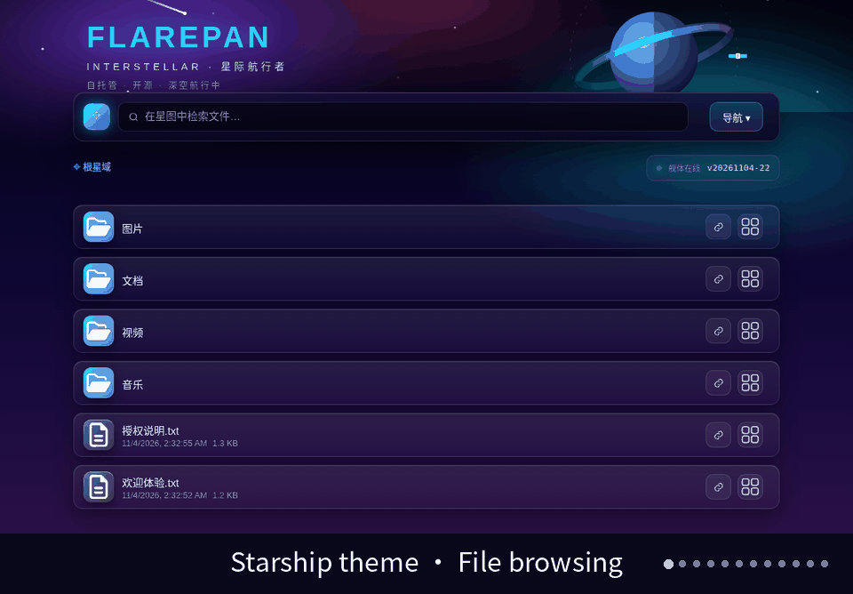
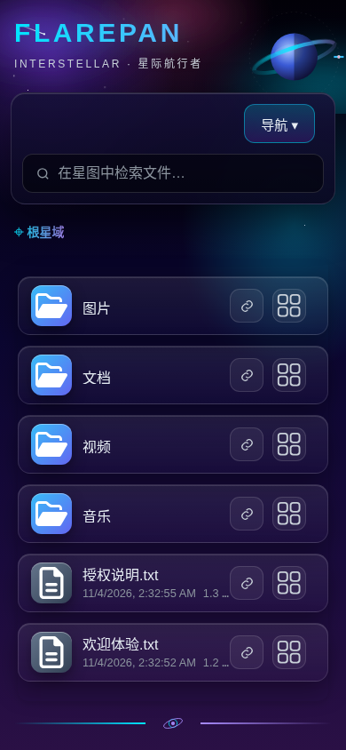
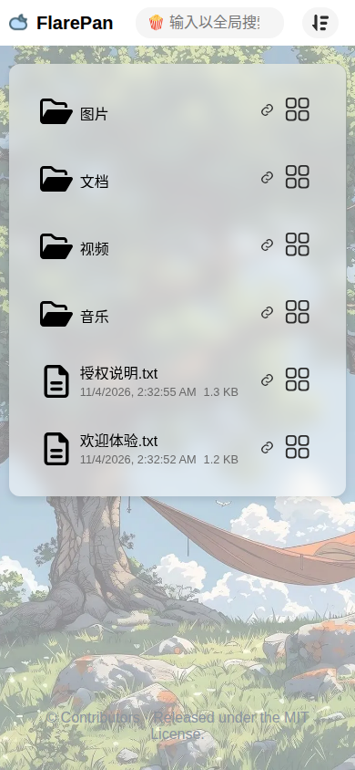
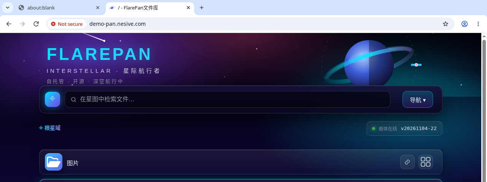

# FlarePan — Self-hosted file library on Cloudflare

> [中文版](./README.md)

FlarePan is a self-hosted file library running on Cloudflare Workers + R2 + D1:
folder browsing, access control, code-protected shares, short links, media
playback, WebDAV, and upload quotas with expiry — all authorized through
the Worker, so the R2 bucket itself never needs public access.

[](https://deploy.workers.cloudflare.com/?url=https://github.com/Nesive/FlarePan)

> If the button flow does not provision D1 / R2 automatically, use the
> CLI deployment below.

## Live demo

Demo site: [demo-pan.nesive.com](https://demo-pan.nesive.com)

Demo account (regular user, not an admin):

- Username: `demo`
- Password: `demo123456`

The demo is isolated from any production data; quotas are 100 MB per
file, 500 MB per day, 5 GB total, and new uploads expire after 24 hours.
Do not store anything important on the demo. DAV works with the demo
account, with write access under the `demo/` directory.

## Screenshots



A real feature tour from the live demo: Starship and Original themes, instant skin switching, planet favicon, multi-account and folder-level permissions, WebDAV, the short-link master switch, in-site Markdown viewing, the bottom audio player, the centered video window, and the image lightbox.

Feature demo video (cut from real screenshots, 94s): [pan-demo.mp4](screenshots/pan-demo.mp4)

<table>
  <tr>
    <td></td>
    <td></td>
  </tr>
  <tr>
    <td align="center">Mobile Starship</td>
    <td align="center">Mobile Original</td>
  </tr>
</table>

Mobile is fully featured too: search, folders, file lists and viewers all work, and both themes switch the same way on phones.



The favicon follows the skin: a transparent planet icon with no white or square background on the browser tab.

## Lineage and thanks

This project is a further development of open-source file libraries,
MIT license retained:

- [ljxi/Cloudflare-R2-oss](https://github.com/ljxi/Cloudflare-R2-oss) — the original R2 file library
- [willow-god/FlareDrive-R2](https://github.com/willow-god/FlareDrive-R2) — a prettier frontend version

Thanks to both authors for their open-source work.

## Features

- **Browse and store**: R2 storage, folder navigation, Chinese paths work
  as-is; PDFs are always served inline, never cached as downloads.
- **Access control**: D1 accounts plus per-folder read / write / none
  rules (no rule means invisible); protected folders are picked from a
  tree selector in the admin backend, at any depth.
- **Shares**: code-protected shares (random slug, code stored only as a
  SHA-256 hash, 5 wrong attempts lock for 15 minutes, cookie grant
  reuse); revoking a share deletes its short link too.
- **Short links**: Sink short-link service, configured in the admin
  backend; a master toggle sits on top of the short-link tab — when off,
  every short-link entry in the frontend and backend hides and the
  short-link API answers `403 shortlink_disabled`.
- **Media playback**: the audio bottom-bar player survives folder
  navigation; PDFs use the native viewer on desktop and a bundled pdf.js
  canvas on mobile; videos open in a centered window (mini / centered /
  fullscreen are orthogonal) and formats the browser cannot play fall
  back to on-demand transcoding (see below).
- **Upload protection**: per-file cap, per-identity daily cap, total
  storage cap, and expiry — all tunable; guests are counted by hashed IP,
  authenticated users by account, raw IPs are never stored; over-quota
  uploads get explicit error codes (see below); expired files are swept
  on each upload.
- **WebDAV**: PROPFIND / GET / HEAD / PUT / DELETE / MKCOL / MOVE /
  COPY; writes always require an authenticated account.
- **Admin backend**: files, protected folders, shares, WebDAV, short
  links, accounts, permissions, and upload limits; the frontend carries
  a version stamp and stale tabs reload themselves when visible again.

The web frontend has no upload UI: uploads go through WebDAV clients,
the admin backend, or the API (simple PUT / multipart upload).

## One-click deploy

Click the Deploy button above and follow Cloudflare's prompts to create
the Worker, R2 bucket, and D1 database, then set the secrets under
"First login". The button flow does not run database migrations, so run
this once afterwards:

```bash
npx wrangler d1 migrations apply flarepan --remote
```

## CLI deployment

```bash
# 1. Log in (or set CLOUDFLARE_API_TOKEN instead)
npx wrangler login

# 2. Create the R2 bucket and D1 database (names must match wrangler.toml)
npx wrangler r2 bucket create flarepan
npx wrangler d1 create flarepan
# Copy the printed database_id into wrangler.toml's d1_databases section

# 3. Set secrets (never put them in code or wrangler.toml)
npx wrangler secret put SESSION_SECRET
# Enter a random string: it signs sessions; empty means unsigned, never leave it empty
npx wrangler secret put READ_ADMIN_PASS_HASH
# Enter the SHA-256 hex of the admin password:
# echo -n 'your-password' | sha256sum

# 4. Deploy ([build] compiles functions/ and assembles static files first)
npx wrangler deploy

# 5. Apply database migrations
npx wrangler d1 migrations apply flarepan --remote
```

## First login

Open `https://your-domain/admin` and log in with `READ_ADMIN_USER`
(default `admin`) and the password from step 3. Afterwards:

1. Create a real admin account on the "Accounts" tab;
2. Delete the `READ_ADMIN_PASS_HASH` secret to disable the environment
   admin fallback (without that secret the env admin is inactive);
3. Adjust the four quota values on the "Upload limits" tab if needed
   (defaults below).

## Configuration

| Variable / secret | Where | Meaning |
| --- | --- | --- |
| `SESSION_SECRET` | secret, required | Random string, signs sessions |
| `READ_ADMIN_USER` | variable | Environment admin username, default `admin` |
| `READ_ADMIN_PASS_HASH` | secret | SHA-256 hex of that admin's password; unset disables it |
| `GUEST` | variable | Guest-writable path prefixes, comma separated, `*` = all; unset means guests read only — use with care on demos |
| `SINK_BASE_URL` / `SINK_SITE_TOKEN` | variable | Short-link service address and key; the admin backend's short-link settings win when fully configured |

Quota settings live in the D1 `settings` table, editable on the admin
"Upload limits" tab. Without a D1 binding all quota checks are skipped
(legacy behavior, not recommended).

| Setting key | Default | Meaning |
| --- | --- | --- |
| `upload_max_file_mb` | 500 | Per-file cap (MB) |
| `upload_daily_mb` | 2048 | Per-identity daily cap (MB, UTC day) |
| `upload_total_mb` | 0 | Total storage cap (MB), 0 = unlimited |
| `upload_expiry_hours` | 0 | Expiry for new uploads (hours), 0 = never |

Over-quota error codes: `upload_too_large` (413),
`daily_quota_exceeded` (429), `storage_quota_exceeded` (507),
`shortlink_disabled` (403).

## Database migrations

`migrations/` apply in order (`wrangler d1 migrations apply flarepan --remote`):

| Migration | Contents |
| --- | --- |
| 0001 | accounts / permission_rules / protected_prefixes / settings |
| 0002 | shares (code-protected shares) |
| 0003 | share_shortlinks (share-to-short-link mapping) |
| 0004 | settings.shortlink_enabled (short-link master switch, default on) |
| 0005 | upload_ledger / upload_reservations (upload ledger and multipart reservations) |

The ledger only counts files uploaded through controlled routes after
the migration; older files do not count toward totals.

## On-demand transcoding (optional)

When a browser cannot play a video (e.g. some MP4 encodings), the player
queues it via `GET /transcode/<source>`: the Worker writes
`_$transcode-jobs$/<key>.json` (contents: `{key, requestedAt}`) to R2 and
later serves `_$transcoded$/<key>.mp4`. Transcoding itself needs a
separate scheduled job you run: read the job JSON → transcode with
ffmpeg to H.264/AAC faststart MP4 → write `_$transcoded$/<key>.mp4` plus
`_$transcoded$/<key>.done.json` (containing the source file's etag and
size, which the Worker uses to validate the cache). Without a transcoder
running, the transcode endpoint stays in "queued" and videos still play
from the original file.

## Local development

```bash
npm install
npm run dev        # wrangler pages dev, local R2 + D1 bindings
```

Run `npx wrangler d1 migrations apply flarepan --local` once before starting
dev; without a `wrangler.toml` that command fails outright with no
configuration file found.

## License

MIT, see [LICENSE](./LICENSE).
