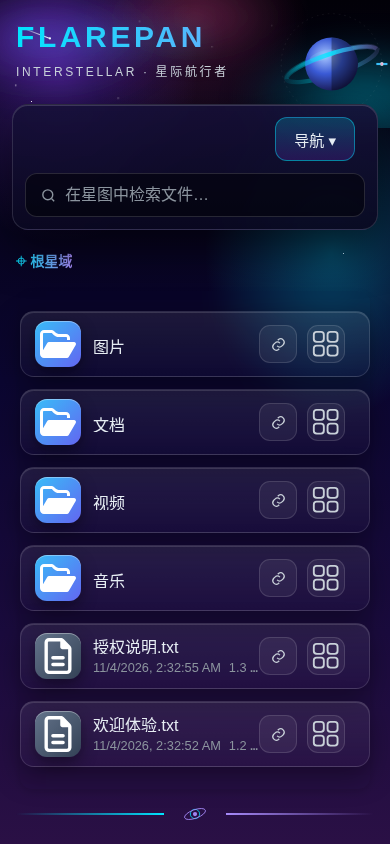
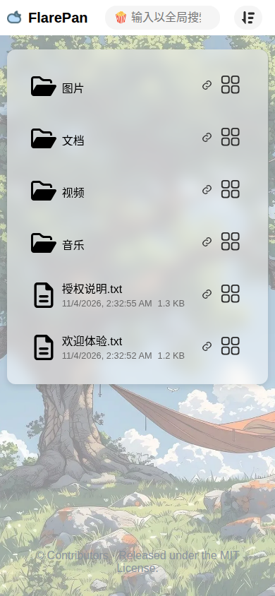
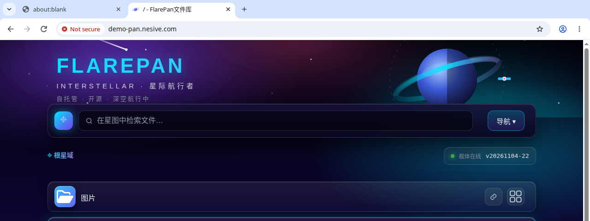

# FlarePan — Cloudflare 上的自托管文件库

> [English version](./README.en.md)

FlarePan 是跑在 Cloudflare Workers + R2 + D1 上的自托管文件库：文件夹浏览、
权限控制、提取码分享、短链、音视频播放、WebDAV、上传额度与过期，
全部经 Worker 鉴权，R2 桶本身不需要开公开访问。

[](https://deploy.workers.cloudflare.com/?url=https://github.com/Nesive/FlarePan)

> 如果按钮流程没有自动建好 D1 / R2，改走下面的命令行部署。

## 在线演示

演示站：[demo-pan.nesive.com](https://demo-pan.nesive.com)

体验账号（普通用户，非管理员）：

- 账号：`demo`
- 密码：`demo123456`

演示站数据与正式数据隔离；额度为单文件 100MB、每天 500MB、
总量 5GB，新上传 24 小时后过期；请勿在演示站存放重要文件。
DAV 可用 demo 账号登录，写权限在 `demo/` 目录下。

## 截图


上面是演示站的真实功能轮播：星际航行者与原始双主题、一键换装、星球 favicon、多账号与文件夹级权限、WebDAV、短链总开关、站内 Markdown 查看、音频底部播放器、视频居中大窗、图片灯箱。

功能演示视频（真实截图剪辑，94 秒）：[pan-demo.mp4](screenshots/pan-demo.mp4)

<table>
  <tr>
    <td></td>
    <td></td>
  </tr>
  <tr>
    <td align="center">手机端星际主题</td>
    <td align="center">手机端原始主题</td>
  </tr>
</table>

手机端同样完整：搜索、文件夹、文件列表与查看器全部可用；两套主题在手机上也一样切换。



换肤即换图标：星球 favicon 为透明底，浏览器页签上无白底无方底。

## 谱系与致谢

本项目是开源网盘的再开发，MIT 协议保留：

- [ljxi/Cloudflare-R2-oss](https://github.com/ljxi/Cloudflare-R2-oss) —— 最初的 R2 网盘实现
- [willow-god/FlareDrive-R2](https://github.com/willow-god/FlareDrive-R2) —— 更美观的前端版本

感谢两位作者的开源工作。

## 功能

- **浏览与存储**：R2 存文件，文件夹导航，中文路径正常显示；PDF 强制
  内联预览，不会被缓存成下载。
- **权限**：D1 存账号与文件夹级读写规则（read / write / none），无规则
  即不可见；受保护文件夹在后台用树选择器勾选，任意深度都行。
- **分享**：提取码分享（slug 随机、码只存 SHA-256 哈希、5 次输错锁
  15 分钟、Cookie 授权复用）；撤销分享会同步删掉对应的短链。
- **短链**：接 Sink 短链服务，后台可配地址与密钥；后台短链页签顶部
  有总开关，关掉时前台与后台全部短链入口隐藏，短链接口回
  `403 shortlink_disabled`。
- **媒体播放**：音频底部播放器跨文件夹导航不中断；PDF 桌面用原生
  预览、手机用自带 pdf.js 画布；视频默认居中大窗（小窗 / 居中 /
  全屏三态正交），浏览器播不了的格式自动走按需转码（见下）。
- **上传防护**：单文件上限、每身份每日量、存储总量、过期时间四项
  可调；访客按 IP 哈希计、当事人按账号计，不存原始 IP；超限返回
  明确的错误码（见下）；过期文件在每次上传时顺带清理。
- **WebDAV**：PROPFIND / GET / HEAD / PUT / DELETE / MKCOL / MOVE /
  COPY，写操作一律要认证账号。
- **管理后台**：文件、受保护文件夹、分享、WebDAV、短链、账号、
  权限、上传限制八个页签；前端带版本戳，旧标签页切回可见时自动
  刷新到新版。

前端目前没有网页上传界面：上传走 WebDAV 客户端、管理后台或
API（简单 PUT / 分片上传）。

## 一键部署

点上面的 Deploy 按钮，按 Cloudflare 的引导建 Worker、R2 桶与 D1 库，
然后按下面「首次登录」设好密钥与管理员。部署完成后仍需手动跑一
次数据库迁移（按钮流程不自动跑迁移）：

```bash
npx wrangler d1 migrations apply flarepan --remote
```

## 命令行部署

```bash
# 1. 登录（或用 CLOUDFLARE_API_TOKEN 环境变量）
npx wrangler login

# 2. 建 R2 桶与 D1 库（名字要和 wrangler.toml 里的一致）
npx wrangler r2 bucket create flarepan
npx wrangler d1 create flarepan
# 把输出的 database_id 填进 wrangler.toml 的 d1_databases 一节

# 3. 设密钥（绝不能写进代码或 wrangler.toml）
npx wrangler secret put SESSION_SECRET
# 输入一串随机字符：会话签名用，留空等于没有签名，绝不能留空
npx wrangler secret put READ_ADMIN_PASS_HASH
# 输入管理员口令的 SHA-256 十六进制：
# echo -n '你的口令' | sha256sum

# 4. 部署（[build] 会先自动编译 functions/ 并组装静态文件）
npx wrangler deploy

# 5. 跑数据库迁移
npx wrangler d1 migrations apply flarepan --remote
```

## 首次登录

打开 `https://你的域名/admin`，用 `READ_ADMIN_USER`（默认 `admin`）
与第 3 步设的口令登录。登录后建议：

1. 在「账号」页建正式管理员账号；
2. 建好后删掉 `READ_ADMIN_PASS_HASH` 密钥，关掉环境变量管理员
   兜底（不设该密钥时 env 管理员自动禁用）；
3. 在「上传限制」页按需要改四项额度（默认见下表）。

## 配置

| 变量 / 密钥 | 位置 | 说明 |
| --- | --- | --- |
| `SESSION_SECRET` | 密钥，必填 | 随机串，会话签名用 |
| `READ_ADMIN_USER` | 变量 | 环境变量管理员用户名，默认 `admin` |
| `READ_ADMIN_PASS_HASH` | 密钥 | 该管理员口令的 SHA-256 十六进制；不设则禁用 |
| `GUEST` | 变量 | 访客可写路径前缀，逗号分隔，`*` = 全部；默认不设 = 访客只读，演示站慎用 |
| `SINK_BASE_URL` / `SINK_SITE_TOKEN` | 变量 | 短链服务地址与密钥；后台短链页签配齐后以后台为准 |

上传额度存在 D1 `settings` 表，后台「上传限制」页签可改。
没有 D1 绑定时额度检查全部跳过（旧行为，不建议）。

| 设置键 | 默认 | 含义 |
| --- | --- | --- |
| `upload_max_file_mb` | 500 | 单文件上限（MB） |
| `upload_daily_mb` | 2048 | 每身份每日量（MB，按 UTC 日） |
| `upload_total_mb` | 0 | 存储总量（MB），0 = 不限 |
| `upload_expiry_hours` | 0 | 新上传过期时间（小时），0 = 永不过期 |

超限时的错误码：`upload_too_large`（413）、
`daily_quota_exceeded`（429）、`storage_quota_exceeded`（507）、
`shortlink_disabled`（403）。

## 数据库迁移

`migrations/` 按顺序跑（`wrangler d1 migrations apply flarepan --remote`）：

| 迁移 | 内容 |
| --- | --- |
| 0001 | accounts / permission_rules / protected_prefixes / settings |
| 0002 | shares（提取码分享） |
| 0003 | share_shortlinks（分享与短链映射） |
| 0004 | settings.shortlink_enabled（短链总开关，默认开） |
| 0005 | upload_ledger / upload_reservations（上传账本与分片预约） |

账本只计迁移之后经受控路径上传的文件，老文件不计入总量。

## 按需转码（可选）

浏览器播不了的视频（例如某些编码的 MP4）会自动向
`GET /transcode/<源文件>` 排队：Worker 在 R2 里写
`_$transcode-jobs$/<key>.json`（内容是 `{key, requestedAt}`），
转码完成后读 `_$transcoded$/<key>.mp4`。转码本身需要你另起一个
定时任务：读任务 JSON → 用 ffmpeg 转 H.264/AAC faststart MP4 →
写回 `_$transcoded$/<key>.mp4`，并写
`_$transcoded$/<key>.done.json`（含源文件的 etag 与 size，供
Worker 校验缓存是否仍有效）。不跑转码任务时，转码接口一直回
排队中，视频仍可原片播放。

## 本地开发

```bash
npm install
npm run dev        # wrangler pages dev，R2 + D1 本地绑定
```

本地 D1 先跑一次 `npx wrangler d1 migrations apply flarepan --local`，
再起 dev；`wrangler.toml` 缺位时该命令会直接报错找不到配置。

## 许可

MIT，见 [LICENSE](./LICENSE)。
